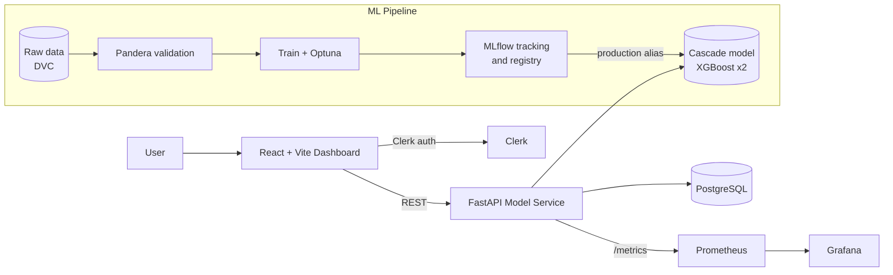

<div align="center">

# 🥛 MilkGuard

### An MLOps-driven Milk Supply Chain Adulteration Detection System

Flag adulterated milk from six routine field readings, identify the likely adulterant, and monitor everything in a live dashboard.

[](https://github.com/<owner>/<repo>/actions/workflows/ci.yml)


</div>

> ⚠️ **Research status: not yet tested on real milk.** All reported results come from a **synthetic** dataset. See [Limitations](#limitations) before relying on any output.

---

## Table of contents

- [Overview](#overview)
- [Key features](#key-features)
- [Application screenshots](#application-screenshots)
- [Architecture](#architecture)
- [Tech stack](#tech-stack)
- [Repository layout](#repository-layout)
- [Getting started](#getting-started)
- [Model, data pipeline and API](#model-data-pipeline-and-api)
  - [Data pipeline](#data-pipeline)
  - [Baselines](#baselines)
  - [Two-stage cascade](#two-stage-cascade)
  - [Results](#results)
  - [Prediction API](#prediction-api)
  - [Model promotion](#model-promotion)
- [Monitoring](#monitoring)
- [CI/CD](#cicd)
- [Project status](#project-status)
- [Limitations](#limitations)
- [Documentation](#documentation)
- [Contributing](#contributing)
- [License](#license)
- [Acknowledgements](#acknowledgements)

---

## Overview

Milk adulteration, such as adding water, starch, urea or detergent, is a serious food-safety and economic problem across dairy supply chains. Laboratory tests are accurate but slow and expensive, so they cannot screen every sample at a collection center.

**MilkGuard** is an end-to-end system that screens samples using only the readings a collection center can measure on the spot:

| Reading | Unit |
| --- | --- |
| Fat | % |
| SNF (solids-not-fat) | % |
| Density | g/mL |
| pH | - |
| Freezing point | °C |
| Conductivity | mS/cm |

A **two-stage XGBoost cascade** does the work:

1. **Stage 1:** scores whether a sample is adulterated (risk score and risk band).
2. **Stage 2:** names the most likely adulterant.

The model is served through a **FastAPI** service, explored through a **React** dashboard, and tracked, versioned and monitored with **MLflow**, **DVC**, **Prometheus** and **Grafana**.

## Key features

- 🔬 **Two-stage detection:** adulteration risk first, then adulterant identification across 8 classes.
- ⚡ **Fast inference:** about 14 ms single-sample p95 locally and about 17 ms in Docker. A 10,000-row CSV batch takes about 1.1 s.
- 🧪 **Safety-first decision bands:** samples are marked `accept`, `retest` or `reject`. Readings outside the training ranges are never silently accepted.
- 📥 **Single and batch prediction:** JSON, raw CSV body or CSV upload, with up to 10,000 samples per request.
- 📊 **Interactive dashboard:** landing page, authenticated sign-in (Clerk), sample analysis and a prediction log.
- 🔁 **Reproducible ML pipeline:** DVC stages, Pandera schema validation, Optuna tuning and MLflow tracking.
- 🏷️ **Gated model promotion:** a new model reaches production only if it beats explicit recall, precision and regression criteria.
- 📈 **Production monitoring:** Prometheus metrics and provisioned Grafana dashboards.
- 🐳 **One-command stack:** `docker compose up --build` runs everything.
- ✅ **CI pipeline:** lint, tests, full `dvc repro`, container smoke test and image publish.

## Application screenshots

Follow the user flow from the public landing page through sign-in, dashboard, sample analysis and prediction history.

### 1. Landing page


### 2. Sign in


### 3. Dashboard


### 4. Sample prediction


### 5. Prediction log


## Architecture



## Tech stack

| Layer | Technologies |
| --- | --- |
| **Frontend** | React, Vite, Tailwind CSS, Clerk (authentication) |
| **Backend / API** | FastAPI, Uvicorn, PostgreSQL |
| **Machine learning** | XGBoost, scikit-learn (Random Forest and Logistic Regression baselines), Optuna |
| **Data and validation** | Pandera, DVC |
| **MLOps** | MLflow (tracking and model registry), GitHub Actions |
| **Monitoring** | Prometheus, Grafana |
| **Infrastructure** | Docker, Docker Compose, GitHub Container Registry |

## Repository layout

```text
.
├── frontend/                 # React + Vite dashboard
├── Monitoring/               # Provisioned Grafana dashboards and data source
├── Model/                    # Python model, API, training pipeline, and tests
├── Screenshots/              # README screenshots
├── docker-compose.yml        # Runs the full local stack
├── prometheus.yml            # Prometheus scrape configuration
├── docs/                     # GUIDE, RUN_LOCALLY and MONITORING guides
└── .github/workflows/        # CI
```

> This project uses **one Git repository**, rooted at this directory. Do not initialize or commit a separate Git repository inside `Model/`. Keeping the model as a normal subdirectory lets the root Compose file and CI track the whole application together.

## Getting started

### Option 1: Run the full application (recommended)

**Prerequisites:** Docker Desktop.

```bash
git clone https://github.com/<owner>/<repo>.git
cd <repo>

# Sign-in uses Clerk: add your publishable key to a root .env file
echo "VITE_CLERK_PUBLISHABLE_KEY=your_key_here" > .env

docker compose up --build
```

| Service | URL |
| --- | --- |
| Dashboard | http://localhost:80 |
| FastAPI docs (Swagger) | http://localhost:8000/docs |
| MLflow | http://localhost:5000 |
| Prometheus | http://localhost:9090 |
| Grafana | http://localhost:3001 |

> 🔒 Grafana's local default login is `admin` / `admin`. **Change it before exposing this stack beyond your computer.**

### Option 2: Run services separately

**Model and API** (see [Quick start](#quick-start-model-and-api) and [`docs/RUN_LOCALLY.md`](docs/RUN_LOCALLY.md)).

**Dashboard**, from `frontend/`:

```bash
cp .env.example .env.local     # set VITE_CLERK_PUBLISHABLE_KEY
npm install
npm run dev
```

### Quick start (model and API)

```bash
cd Model
python -m venv .venv && . .venv/bin/activate
pip install -e ".[dev]"

dvc repro                                           # ingest -> validate -> eda -> split -> baselines -> augment -> train -> evaluate -> promote
mlflow ui --backend-store-uri sqlite:///mlflow.db   # browse runs
pytest -q                                           # run tests
uvicorn milk_adulteration.api.app:app --reload      # API on :8000, docs at /docs
```

Install only what you need:

| Command | Installs |
| --- | --- |
| `pip install -e .` | Load and run the model |
| `pip install -e ".[serve]"` | API |
| `pip install -e ".[train]"` | Training pipeline |
| `pip install -e ".[dev]"` | Everything, plus tests |

---

## Model, data pipeline and API

> All results below are on **synthetic data**. See [Limitations](#limitations).

### Data pipeline

The pipeline is defined as DVC stages and runs end to end with `dvc repro`.

| Stage | Module | Output |
| --- | --- | --- |
| `ingest` | `milk_adulteration.data.ingest` | `data/raw/milk_combined_full_dataset.csv`, checked against the SHA-256 in `params.yaml` |
| `validate` | `milk_adulteration.data.validate` | `data/interim/milk_clean.csv` (six features, IDs, labels) and `milk_rejected.csv` (failed rows with a reason) |
| `eda` | `milk_adulteration.eda` | [`reports/eda.md`](Model/reports/eda.md), `reports/eda_summary.json` (DVC metrics) |
| `split` | `milk_adulteration.data.split` | `data/processed/{train,val,test}.csv`: 70/15/15, stratified on adulterant class, seed 42 |
| `baselines` | `milk_adulteration.models.baselines` | [`reports/baselines.md`](Model/reports/baselines.md), `reports/baselines.json`, one MLflow run per model |
| `augment` | `milk_adulteration.data.augment` | `data/processed/train_aug.csv`: every Stage 2 class grown to 300 rows, plus water+starch and water+urea rows |
| `train` | `milk_adulteration.models.train` | `models/cascade.joblib`, `reports/train_cv.json`; Optuna trials as nested MLflow runs |
| `evaluate` | `milk_adulteration.models.evaluate` | [`reports/model.md`](Model/reports/model.md), `reports/model_metrics.json` |
| `promote` | `milk_adulteration.models.promote` | Registers the model in MLflow and moves the `production` alias if it earns it. Writes `models/model_info.json` and [`reports/promotion.json`](Model/reports/promotion.json) |

**Dataset.** The source is the CC0 [Indian Milk Adulteration Detection Dataset](https://github.com/ommadav/Indian-Milk-Adulteration-Detection-Dataset) (2,500 rows, **synthetic**). Only the six field-level readings are kept. The lab-only columns (HPLC, GC-MS, strip tests) are dropped so the model matches what a collection center can measure. `Specific_Gravity` is used as density.

**Labels.** `adulterant` maps the 11 source adulterants to 8 v1 classes:

`water` · `starch` · `urea` · `detergent` · `sodium_bicarbonate` · `glucose` · `skimmed_milk_powder` · `other` (formalin, hydrogen peroxide, vegetable oil, melamine)

Pure rows are labelled `none`.

**Schema** (`milk_adulteration.data.schema`).

- `FIELD_SCHEMA` checks the six inputs: no nulls and plausible ranges. It is reused by the API.

| Field | Accepted range |
| --- | --- |
| Fat, SNF | 0 – 15 % |
| Density | 1.000 – 1.040 |
| pH | 5.5 – 8.5 |
| Freezing point | −1.0 – 0 °C |
| Conductivity | 2 – 10 mS/cm |

- `CLEAN_SCHEMA` adds unique sample IDs, dates and label consistency.

> No DVC remote is configured yet. Add one with `dvc remote add -d storage <url>` and `dvc push` to share cached data.

### Baselines

Full tables with 95% bootstrap CIs are in [`reports/baselines.md`](Model/reports/baselines.md).

- **FSSAI rules** (`models/rules.py`, fixed published thresholds): precision 1.00 but recall 0.53 on test.
- **Logistic regression** fails. The adulterant signals point in opposite directions (water lowers density, glucose raises it), which a linear model can't separate.
- **Random Forest + derived features:** test PR-AUC 0.93.
  - Formalin and H₂O₂ (class `other`) look like pure milk, so reaching recall ≥ 0.95 on *all* adulterants means flagging most samples.
  - On the detectable adulterants (`other` removed) it reaches recall 1.00 and precision 1.00 (12 of 12, no false alarms).
- **Stage 2** (which adulterant): best CV macro-F1 is 0.77 (Random Forest), under the 0.80 target. Starch and skimmed milk powder both raise SNF and get confused.

**Derived features** (`features.py`): fat/SNF ratio, density residual versus Richmond's formula, and freezing-point deviation from −0.52 °C.

MLflow runs are tagged with the SHA-256 of each split file and the git commit. Tracking uses a local SQLite store (`mlflow.db`, not committed).

### Two-stage cascade

Full results are in [`reports/model.md`](Model/reports/model.md).

```python
from milk_adulteration.models.cascade import Cascade

model = Cascade.load("models/cascade.joblib")
model.predict(df)  # is_adulterated, risk_score, band, adulterant, confidence
```

- **Recall target scope.** The recall target covers the *detectable* adulterants. `other` (formalin, H₂O₂, vegetable oil, melamine) looks like pure milk in the six readings and goes to a confirmatory lab test. Stage 1 does not train on it (`train.stage1_exclude_other`).
- **Augmentation** (`data/augment.py`) uses "shift transplant": a random pure training row plus the measured shift of a real adulterated training row, scaled by a dose of 0.5–1.5×. A physical mixing model was not used because the source data does not follow one. Its water rows imply 12–40% dilution depending on which reading you use.
- **Tuning.** Optuna runs 30 trials per stage on 5-fold CV over real training rows. Each fold is augmented from its own training part and scored only on real rows.
- **Calibration and threshold.**
  - Isotonic calibration is fitted on out-of-fold scores of real rows.
  - Samples are flagged on the raw Stage 1 score, at a threshold picked on validation for recall ≥ 0.95 and moved halfway to the next lower score for a safety margin.
  - It is lowered further if needed so that no sample with calibrated risk ≥ 0.5 is ever accepted.
  - Flagged samples with risk ≥ 0.5 are `reject`, the rest `retest`. Unflagged samples with readings outside the training ranges are also `retest`.
- **Pure-milk widening.** 2,000 extra pure rows are stretched onto typical published cow and buffalo ranges (`augment.widen_pure`). See [`docs/GUIDE.md`](docs/GUIDE.md) for why and what it costs.

### Results

| Test metric (detectable adulterants) | Result | Target |
| --- | --- | --- |
| Stage 1 recall | 1.00 (12/12) | ≥ 0.95 |
| Stage 1 precision | 1.00 (0 false alarms) | ≥ 0.80 |
| Stage 2 macro-F1 (test / train CV) | 0.62 (19 samples) / 0.80 | ≥ 0.80 |
| Single-sample p95 latency | ~14 ms | < 100 ms |

On **all** adulterants, including `other`, Stage 1 catches 16 of 19 with no false alarms. The Random Forest baseline needed 213 false alarms to catch all 19.

### Prediction API

| Endpoint | Purpose |
| --- | --- |
| `POST /predict` | One sample → `is_adulterated`, `risk_score`, `band`, `adulterant`, `confidence`, `unusual_readings`, `model_version`. Out-of-range or non-numeric readings get a 422 with the reason. Readings outside what the model saw in training are listed in `unusual_readings` and never accepted. |
| `POST /predict/batch` | Up to 10,000 samples as JSON, a CSV body (`text/csv`) or a CSV upload (multipart field `file`). Per-row results plus a summary. Invalid rows are returned as `rejected` with a reason, never scored. |
| `GET /model/info` | Registry version, MLflow run ID, data hashes, threshold, test metrics |
| `GET /health` | Liveness |
| `GET /metrics` | Prometheus: request counts and latency by route, predictions by band, adulterant and collection point, rejected rows, risk-score histogram |

**Example requests**

```bash
# Single sample
curl -s localhost:8000/predict -H 'content-type: application/json' -d '{
  "sample_id": "S-1", "collection_point": "Farm Gate", "fat_pct": 2.2, "snf_pct": 6.9,
  "density": 1.019, "ph": 6.9, "freezing_point": -0.46, "conductivity": 4.2}'

# Batch CSV upload
curl -s localhost:8000/predict/batch -F file=@samples.csv
```

**Docker image.** Build after `dvc repro`, because the image bundles `models/cascade.joblib`:

```bash
docker compose up --build                         # full stack, from the repository root
# or just the API image, from Model/:
docker build -t milk-adulteration-api .
python Model/scripts/smoke_test.py                # checks every endpoint against a running API
```

The image runs as a non-root user with a health check. It uses `xgboost-cpu` (same library, without the ~300 MB CUDA dependency). Runtime pins in `requirements/serve.txt` must match the training versions because the model is a pickle. Measured in the container: `/predict` p95 ≈ 17 ms, and a 10,000-row CSV batch takes ≈ 1.1 s.

### Model promotion

A model gets the MLflow `production` alias only if, on detectable test adulterants, it:

- meets **recall ≥ 0.95** and **precision ≥ 0.80**, and
- is **no worse** than the current production model on PR-AUC and recall.

Ties promote, so a retrain on new data can replace the old model. Set `MLFLOW_TRACKING_URI` to use a shared MLflow server instead of the local `mlflow.db`.

## Monitoring

The API exposes Prometheus metrics at `/metrics`, and Grafana dashboards are provisioned automatically from `Monitoring/`. Tracked signals include request volume and latency per route, predictions by band, adulterant and collection point, rejected rows, and the risk-score distribution.

See [`docs/MONITORING.md`](docs/MONITORING.md) for details.

## CI/CD

The workflow in [`.github/workflows/ci.yml`](.github/workflows/ci.yml) runs:

1. **Lint and tests**, including schema and API tests.
2. **Full `dvc repro`** to verify the pipeline end to end.
3. **Build the Docker image** and smoke-test the container.
4. **Push** to `ghcr.io/<owner>/<repo>/api` from `main` or a `v*` tag, only if the model is promoted.

## Project status

| Week | Milestone | Status |
| --- | --- | --- |
| 1 | Data in: download, EDA, Pandera schema, DVC | ✅ Done |
| 2 | Baselines: FSSAI rules, logistic regression, Random Forest | ✅ Done |
| 3 | Two-stage XGBoost, augmentation, calibration | ✅ Done (exit criterion met) |
| 4 | FastAPI service, Docker, GitHub Actions | ✅ Done |
| 5 | React dashboard, PostgreSQL, Prometheus + Grafana | ✅ Done |
| 6 | Validation on real data, SHAP report, write-up | 🔜 Next |

## Limitations

- **Synthetic data only.** The dataset is synthetic, so metrics do not predict real-world performance.
- **Physics stress test.** A [stress test](Model/reports/stress_test.md) found the first model flagged **39%** of pure cow milk across published normal ranges. Training now widens pure milk to those ranges, which brings that to **0.6%** for cow milk. **Buffalo milk is still flagged at 25%.**
- **Undetectable adulterants.** Formalin, hydrogen peroxide, vegetable oil and melamine (`other`) look like pure milk in the six readings and need a confirmatory lab test.
- **Stage 2 accuracy.** Adulterant identification is below target on the held-out test set (macro-F1 0.62 on 19 samples, 0.80 in train CV). Starch and skimmed milk powder are easily confused.
- **Small test set.** Test-set metrics rest on very few adulterated samples (12 detectable, 19 total), so confidence intervals are wide.
- **Not a regulatory tool.** MilkGuard is a screening aid, not a replacement for certified laboratory testing.

To score real samples on your own computer, follow [`docs/RUN_LOCALLY.md`](docs/RUN_LOCALLY.md). [`docs/GUIDE.md`](docs/GUIDE.md) covers retraining, GPU training (faster, not more accurate) and further limitations.

## Documentation

| Guide | Contents |
| --- | --- |
| [`docs/GUIDE.md`](docs/GUIDE.md) | Retraining, GPU training, design rationale, limitations |
| [`docs/RUN_LOCALLY.md`](docs/RUN_LOCALLY.md) | Scoring real samples on your own machine |
| [`docs/MONITORING.md`](docs/MONITORING.md) | Prometheus and Grafana monitoring stack |
| [`Model/reports/`](Model/reports) | EDA, baselines, model, stress-test and promotion reports |

## Contributing

Contributions are welcome.

1. Fork the repository and create a feature branch.
2. Make your changes, with tests where relevant (`pytest -q` in `Model/`).
3. Make sure lint and CI checks pass.
4. Open a pull request describing the change.

## License

Add your license here (for example MIT) and include a `LICENSE` file in the repository root. The training dataset is released under CC0.

## Acknowledgements

- [Indian Milk Adulteration Detection Dataset](https://github.com/ommadav/Indian-Milk-Adulteration-Detection-Dataset) (CC0)
- FSSAI published standards for milk composition
- The open-source communities behind XGBoost, MLflow, DVC, FastAPI, Pandera, Optuna, Prometheus and Grafana

---

<div align="center">

Built by **Akshay Nazare**

</div>